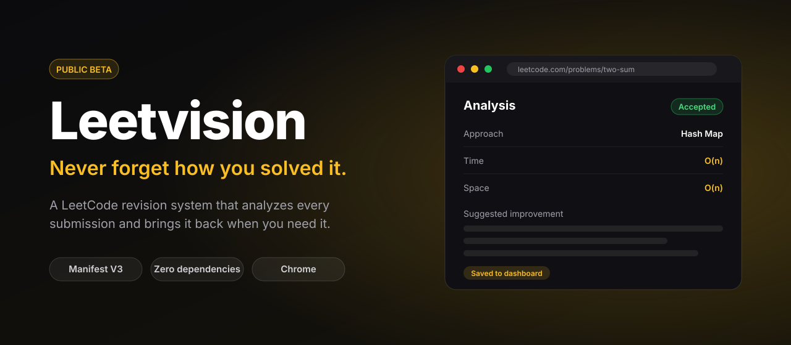
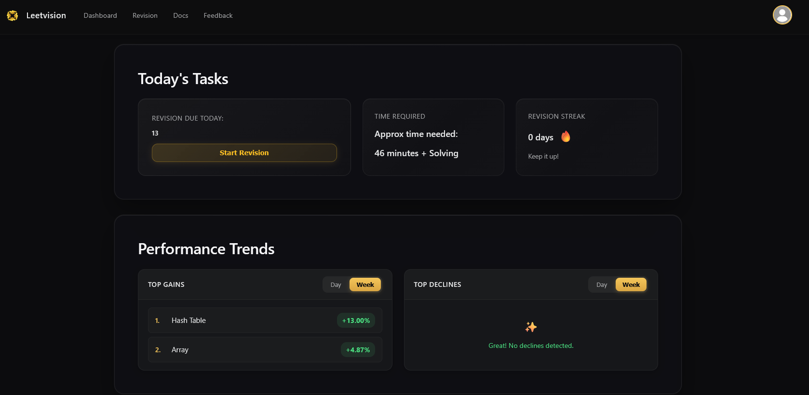
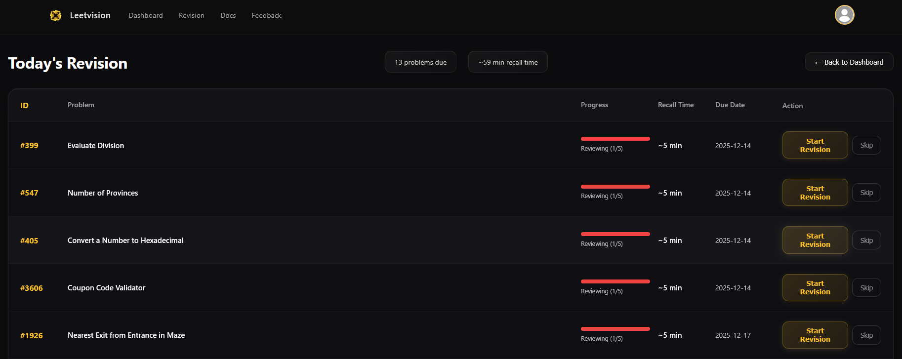
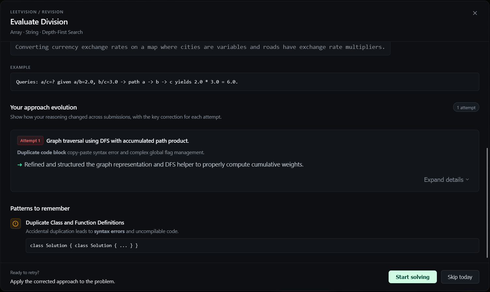
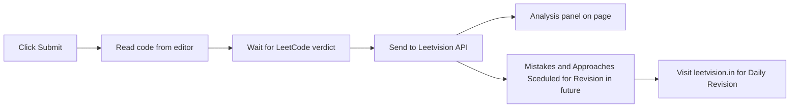

<div align="center">



<br>

<a href="https://github.com/Ashwin-S-10/Leetvision_extension/stargazers">
  
</a>

<br><br>

**A LeetCode revision system that lives in your browser.**
Submit a solution, get an instant analysis, and revise it later on a schedule.

<br>

[](../../issues)
[](#how-it-works)
[](#how-it-works)
[](https://leetvision.in)

[**Website**](https://leetvision.in) · [**Install**](#install) · [**Getting started**](#getting-started) · [**Report a bug**](../../issues)

</div>

<br>

> [NOTE]
> Leetvision is in **public beta**. Expect rough edges, and please [report anything that breaks](../../issues).

## Overview

Most people solve a LeetCode problem once and forget the approach a week later. Leetvision fixes that.

The extension watches your submissions, **Schedules** the problems you solve for revision based on **approach and attempts taken to solve**. Every attempt is saved to your account on [leetvision.in](https://leetvision.in), so you can come back and revise the approaches you used.

## Screenshots

<div align="center">

**Today's Tasks: what's due, how long it takes, and your streak**



<br><br>

**Revision queue: every problem due today, with recall time**



<br><br>

**Approach analysis across multiple attempts**



</div>

## Features

| Feature | What you get |
|---|---|
| **Instant analysis** | Approach, time and space complexity, correctness notes, mistakes, and suggested improvements, right on the problem page. |
| **Revision system** | Every submission is saved and scheduled for review **smartly, based on your approach and number of attempts**, with progress tracking per problem. |
| **Performance trends** | Top gains and declines by topic, by day or by week. |
| **Revision streak** | A daily streak and time estimate to keep you consistent. |
| **Bring your own key** | Out of free analyses? Add your own Gemini API key in [Settings](https://leetvision.in/settings). |
| **Privacy first** | Runs only on `leetcode.com` and sends data only when you click **Submit**. |

## What happens when you click Submit



The extension sends the **code**, **language**, **problem slug** and **verdict**. Nothing else.

## Install

> [!IMPORTANT]
> The extension is not on the Chrome Web Store yet.

**1. Get the code**

Click **Code → Download ZIP** and unzip it, or clone the repo:

```bash
git clone https://github.com/Ashwin-S-10/Leetvision_extension.git
```

**2. Load it in Chrome**

1. Open `chrome://extensions`
2. Turn on **Developer mode** (top-right toggle)
3. Click **Load unpacked** and pick the folder that contains `manifest.json`
4. Pin the Leetvision icon to your toolbar

<details>
<summary><b>Updating later</b></summary>

Pull or re-download the code, click the reload icon on the Leetvision card in `chrome://extensions`, then refresh any open LeetCode tabs.

</details>

## Getting started

1. Create an account at [leetvision.in](https://leetvision.in), or click **Sign Up** in the extension popup.
2. Click the Leetvision icon and sign in with the same email and password.
3. Open any problem on [leetcode.com](https://leetcode.com), write a solution and click **Submit**.
4. The analysis panel appears once LeetCode returns a verdict.

### Free analyses and your own Gemini key

Each account gets a limited number of free analyses per day. When you run out, the extension tells you. You can keep going by adding your own Google Gemini API key in [Settings](https://leetvision.in/settings).

## Privacy

The extension only runs on `leetcode.com`. It sends data to the Leetvision API only when you click **Submit**, and what it sends is:

- the code in the editor
- the language
- the problem slug (for example `two-sum`)
- LeetCode's verdict for that submission

It does not read other sites, your browsing history or your clipboard. Sign-in tokens are kept in the browser's extension storage (`chrome.storage.local`) and are removed when you sign out.

### Permissions

| Permission | Why it is needed |
|---|---|
| `storage` | Keeps you signed in between browser sessions. |
| `activeTab` | Lets the popup interact with the tab you are on. |
| `https://leetcode.com/*` | Reads your code and the submission verdict on LeetCode. |

## How it works

Plain JavaScript on Manifest V3. **No build step, no dependencies.**

```
LeetCode page
 ├─ main-world.js   reads the Monaco editor (runs in the page's own JS context)
 ├─ extractor.js    finds the problem slug, gets the code, waits for the verdict
 ├─ content.js      hooks the Submit button and manages tokens
 └─ ui.js           draws the analysis panel and notifications
        │
        ▼  chrome.runtime.sendMessage
background.js       service worker that makes the API calls
        │
        ▼
Leetvision API      analyzes the code and stores the submission

popup.html/js       sign in, sign out, link to the dashboard
config.js           API and website URLs
```


## Contributing

Bug reports, ideas and pull requests are welcome. Read [CONTRIBUTING.md](CONTRIBUTING.md) before you start.

## License

A license has not been chosen yet. Until one is added, all rights are reserved by the project authors.

<br>

<div align="center">

**If Leetvision helps your prep, consider starring the repo.**

</div>
